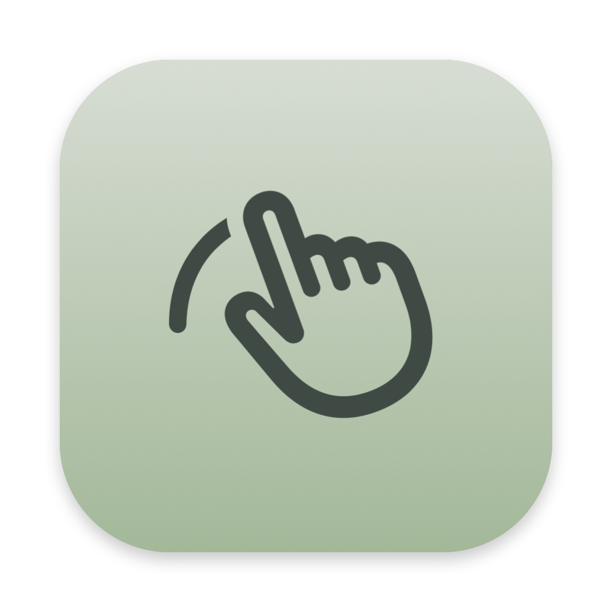
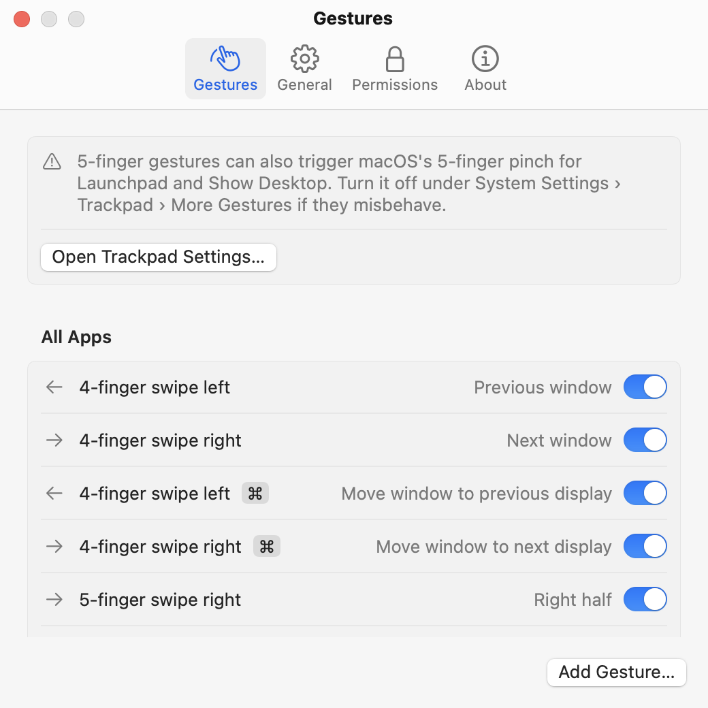
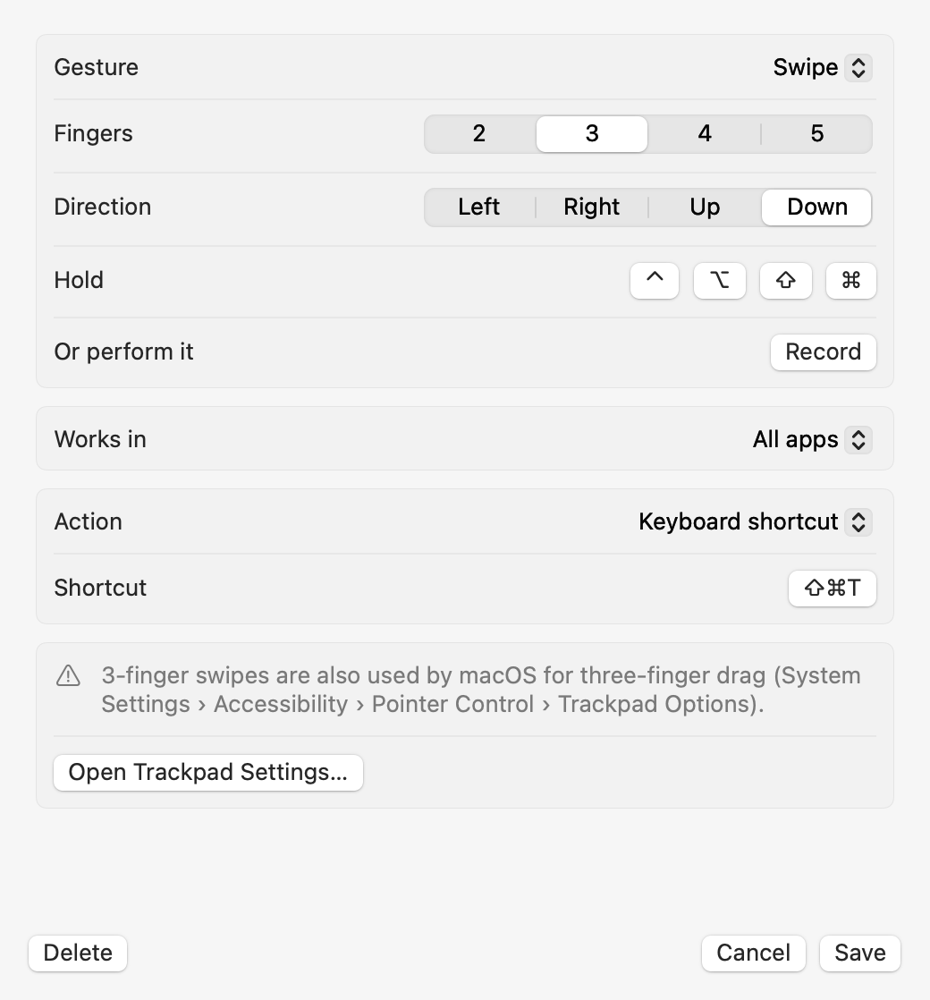

# OpenGestures

<p align="center"></p>

Free, open-source gestures for your Mac's trackpad, built-in or Magic Trackpad, mapped to whatever you want. For now you build it from source, because signed downloads need a paid Apple Developer account. A signed download will come if people find the app useful.

OpenGestures is a small menu bar app. You pick a gesture, optionally hold modifier keys, optionally limit it to one app, and choose what it does. Everything lives in one readable config file that you can keep in git.

## Screenshots

<p align="center">
<picture>
  <source media="(prefers-color-scheme: dark)" srcset="docs/images/gestures-dark.png">
  
</picture>
&nbsp;
<picture>
  <source media="(prefers-color-scheme: dark)" srcset="docs/images/editor-dark.png">
  
</picture>
</p>

The settings window lists your bindings, and the editor turns a gesture into an action. Both are views of the same config file. The warning at the top is OpenGestures noticing a clash with a macOS gesture. It never changes your system settings.

## What it does

Out of the box, these gestures are bound.

- Swipe left or right with 4 fingers to jump to the previous or next recently used window. It goes straight there, including to windows of other apps and other Spaces. See "Walking through windows" below.
- Hold ⌘ and swipe left or right with 4 fingers to move the focused window to the previous or next display.
- Swipe left or right with 5 fingers to put the focused window on the left or right half of the screen.
- Tap with 4 fingers to maximize the focused window, and tap again to restore it. Tap with 5 fingers to center it.
- Rest one finger and tap a second one to its right or left (TipTap) for the next or previous track.
- Slide one finger along the right edge for volume, or along the left edge for brightness.

All of them are ordinary bindings. Edit them, remove them, or add your own in the settings window (⌘,) or in the config file.

## Supported gestures

Each gesture has an id, which is how it appears in the config file. Any gesture can be combined with a set of modifier keys, and the same gesture with different modifiers is a different trigger.

```
swipe.<2-5>.<left|right|up|down>   swipe with 2 to 5 fingers
tap.<1-5>                          tap with 1 to 5 fingers
pinch.<2-5>.<in|out>               pinch with 2 to 5 fingers
rotate.<cw|ccw>                    two-finger rotate, clockwise or counterclockwise
tiptap.<left|right>                one finger rests, another taps to its left or right
edgeswipe.<left|right|top|bottom>  one finger swipes in from an edge
cornertap.<topleft|topright|bottomleft|bottomright>
                                   one finger taps in a corner
edgeslide.<left|right|top|bottom>  one finger slides along an edge (continuous)
```

An edge slide reports a value while you move, so it only pairs with the adjust action (volume or brightness). Every other gesture fires once.

## Supported actions

Keyboard and system

- keyboardShortcut: press a key combination, for example ⌘⇧T
- systemKey: playPause, nextTrack, previousTrack, volumeUp, volumeDown, mute, brightnessUp, brightnessDown, missionControl, appExpose, launchpad, showDesktop
- adjust: volume or brightness, for edge slides
- mouseClick: left, right or middle click at the cursor

Open and run

- openApp: by bundle identifier
- openURL
- openFile
- shellScript: runs through `/bin/zsh -lc`
- appleScript
- shortcut: runs a shortcut from the Shortcuts app by name

Windows and displays

- previousWindow, nextWindow: walk through windows in most recently used order, see below
- previousDisplay, nextDisplay: move the focused window to the neighbouring display. Displays are ordered left to right and wrap around. The window keeps its size, shrunk to fit if needed, and its relative position. A window that fills its screen fills the new one.
- cursorToNextDisplay
- windowLayout: maximize, center, leftHalf, rightHalf, topHalf, bottomHalf, topLeft, topRight, bottomLeft, bottomRight

A binding runs one action. Window layouts are triggered by a gesture only. There is no drag-to-edge snapping.

### Walking through windows

The first previous-window gesture takes you back to the window you came from. Keep swiping and you go further back through all your windows, one per swipe, however slowly you swipe. Next-window walks the other way, starting from the least recently used window, and both wrap around. The walk ends when you pick a window yourself, by clicking it or switching with the keyboard. From then on the order starts fresh: the window you walked to counts as used, then the one you picked.

### Restoring a window after a layout

Run the same layout again on a window that is already in that layout, and it goes back to the size and position it had before. Dragging a laid-out window by its title bar also restores its size under the cursor. Windows that round their size, such as a snapped Terminal window, restore the same way.

## Requirements

- macOS 27. It builds on macOS 14 and later, but it is supported and tested on macOS 27 only.
- Apple Silicon.
- A trackpad, built-in or Magic Trackpad. Magic Mouse is not supported.
- Command Line Tools for Xcode, to build it.

## Install

OpenGestures is installed by building it from source. Signed and notarized downloads need a paid Apple Developer account, which costs $99 a year, and I would rather not pay that before I know anyone wants the app. A star on the repository or an issue telling me what you use it for helps show that.

Install the Command Line Tools if you do not have them:

```
xcode-select --install
```

Clone the repository, build the app and install it to `~/Applications`:

```
git clone https://github.com/01wil/OpenGestures.git
cd OpenGestures
./scripts/build-app.sh
./scripts/install.sh
```

The build prints a number of compiler and linker warnings. They are harmless. It ends with a line saying where the app was built.

Optional, recommended if you will rebuild: before the build, run `./scripts/make-signing-cert.sh` once to create a local signing certificate. See "Why the signing certificate" below.

Open OpenGestures from `~/Applications` and click Allow Access when asked, then turn OpenGestures on in System Settings › Privacy & Security › Accessibility. The status in the app updates live, so no restart is needed.

### Why the signing certificate

You can skip the certificate. The app then works the same, until you rebuild it.

macOS ties the Accessibility grant to the app's signature. `make-signing-cert.sh` creates a self-signed "OpenGestures Local Dev" certificate in your login keychain, valid for 5 years, and `build-app.sh` signs with it automatically. That keeps the signature identity the same across rebuilds, so the grant survives updates. macOS asks for your login password to trust the certificate. If you cancel that dialog, run the script again. It asks again and does not create a duplicate. macOS also asks for the password on every build ("codesign wants to access key ..."). Click Allow, not Always Allow, so nothing else can sign with the key without asking. The app is signed with the hardened runtime.

Without the certificate the build is ad-hoc signed, and an ad-hoc signature changes with every build. The switch in System Settings then still looks on, but macOS no longer honours it and no gesture action runs. To fix that, remove OpenGestures from the Accessibility list with the minus button and add it again. You can also sign with any other identity: `OG_SIGN_IDENTITY="Your Identity" ./scripts/build-app.sh`.

## Configuration

The settings window and the config file are two views of the same data. Changes in the window are written to the file, and edits you make in a text editor are picked up within a moment, with no restart.

The file is `~/.config/opengestures/config.json`. If `XDG_CONFIG_HOME` is set, it is `$XDG_CONFIG_HOME/opengestures/config.json`. The app creates it with the defaults on first run. It is plain JSON with a schema version, so it works well in a dotfiles repo, and a symlink into that repo is fine. To set up a new Mac, copy the file over before you first launch the app.

If you save a file that is not valid, the app shows the error and keeps running with the last valid configuration. It never overwrites a file it could not read.

This is the default configuration:

```json
{
  "bindings" : [
    {
      "action" : { "type" : "previousWindow" },
      "apps" : [],
      "enabled" : true,
      "gesture" : "swipe.4.left",
      "id" : "0F1E2D3C-0001-4000-8000-000000000001",
      "modifiers" : [],
      "name" : "Previous window"
    },
    {
      "action" : { "type" : "nextWindow" },
      "apps" : [],
      "enabled" : true,
      "gesture" : "swipe.4.right",
      "id" : "0F1E2D3C-0002-4000-8000-000000000002",
      "modifiers" : [],
      "name" : "Next window"
    },
    {
      "action" : { "type" : "previousDisplay" },
      "apps" : [],
      "enabled" : true,
      "gesture" : "swipe.4.left",
      "id" : "0F1E2D3C-0003-4000-8000-000000000003",
      "modifiers" : [ "cmd" ],
      "name" : "Move window to previous display"
    },
    {
      "action" : { "type" : "nextDisplay" },
      "apps" : [],
      "enabled" : true,
      "gesture" : "swipe.4.right",
      "id" : "0F1E2D3C-0004-4000-8000-000000000004",
      "modifiers" : [ "cmd" ],
      "name" : "Move window to next display"
    },
    {
      "action" : { "layout" : "rightHalf", "type" : "windowLayout" },
      "apps" : [],
      "enabled" : true,
      "gesture" : "swipe.5.right",
      "id" : "6349CB89-9A09-4589-864E-A2FA5024B2CF",
      "modifiers" : []
    },
    {
      "action" : { "layout" : "leftHalf", "type" : "windowLayout" },
      "apps" : [],
      "enabled" : true,
      "gesture" : "swipe.5.left",
      "id" : "B0B37239-E0BC-4BA1-A4E4-2F9798C17D7F",
      "modifiers" : []
    },
    {
      "action" : { "layout" : "maximize", "type" : "windowLayout" },
      "apps" : [],
      "enabled" : true,
      "gesture" : "tap.4",
      "id" : "38FE07E9-9CC1-49B7-92F2-06E9729CD628",
      "modifiers" : []
    },
    {
      "action" : { "layout" : "center", "type" : "windowLayout" },
      "apps" : [],
      "enabled" : true,
      "gesture" : "tap.5",
      "id" : "FE46E500-D1E8-45C3-876B-BF390E278544",
      "modifiers" : []
    },
    {
      "action" : { "key" : "nextTrack", "type" : "systemKey" },
      "apps" : [],
      "enabled" : true,
      "gesture" : "tiptap.right",
      "id" : "9EB22F46-DC30-499E-B4DB-A6B3F0C6034C",
      "modifiers" : []
    },
    {
      "action" : { "key" : "previousTrack", "type" : "systemKey" },
      "apps" : [],
      "enabled" : true,
      "gesture" : "tiptap.left",
      "id" : "5323397C-6E81-4CE7-B925-1430D143D0D5",
      "modifiers" : []
    },
    {
      "action" : { "target" : "volume", "type" : "adjust" },
      "apps" : [],
      "enabled" : true,
      "gesture" : "edgeslide.right",
      "id" : "04B9F741-B0A1-4196-B206-AA15C09E9913",
      "modifiers" : []
    },
    {
      "action" : { "target" : "brightness", "type" : "adjust" },
      "apps" : [],
      "enabled" : true,
      "gesture" : "edgeslide.left",
      "id" : "C5BA5ADD-6FCC-4B8D-85BA-ED3F353B77FC",
      "modifiers" : []
    }
  ],
  "settings" : {
    "enabled" : true,
    "launchAtLogin" : true,
    "sensitivity" : 0.65,
    "showMenuBarIcon" : true
  },
  "version" : 1
}
```

Modifiers are `cmd`, `shift`, `ctrl` and `opt`. Only `gesture` and `action` are required in a binding. `id`, `modifiers`, `apps`, `enabled` and `name` can be left out when you write a binding by hand. Sensitivity runs from 0 to 1, and higher reacts to smaller movements.

A binding limited to one app lists its bundle identifiers in `apps`. While that app is in front, it wins over a global binding for the same gesture and modifiers. This one turns a 3-finger tap into a new tab in Safari:

```json
{
  "gesture": "tap.3",
  "apps": ["com.apple.Safari"],
  "action": { "type": "keyboardShortcut", "key": "t", "modifiers": ["cmd"] }
}
```

A keyboard-shortcut binding with its own modifiers. Hold ⌥ and pinch out with 2 fingers to press ⌘⇧= in any app:

```json
{
  "gesture": "pinch.2.out",
  "modifiers": ["opt"],
  "action": { "type": "keyboardShortcut", "key": "=", "modifiers": ["cmd", "shift"] }
}
```

Keys are a lowercase character, or one of `return`, `tab`, `space`, `escape`, `delete`, `left`, `right`, `up`, `down`, `f1` to `f20`.

Other actions look like this:

```json
{ "type": "openURL", "url": "https://example.com" }
{ "type": "shellScript", "script": "open -a Terminal" }
{ "type": "systemKey", "key": "missionControl" }
{ "type": "windowLayout", "layout": "leftHalf" }
{ "type": "adjust", "target": "volume" }
```

## Conflicts with macOS gestures

macOS uses some of the same gestures. By default, 4-finger swipes switch between Spaces and full-screen apps, which clashes with the default bindings. macOS also reacts to 5-finger swipes when its 4-finger swipes are on, so a 5-finger binding clashes too. Its 5-finger pinch for Launchpad and Show Desktop can trip on any 5-finger gesture. When an enabled binding overlaps a macOS gesture that is switched on, OpenGestures shows a warning that says which one, with a button that opens Trackpad settings. The setting to change is in System Settings › Trackpad › More Gestures. OpenGestures reads those settings and never changes them.

## Uninstall

```
./scripts/uninstall.sh
```

It quits the app, resets its Accessibility permission, moves `~/Applications/OpenGestures.app` to the Trash and unregisters it from Launch Services. Removing the app also removes its login item. The script asks before it deletes `~/.config/opengestures` and before it removes the signing certificate. `--all` answers yes to both. It touches nothing else. To remove only the certificate, run `./scripts/remove-signing-cert.sh`.

## Security

- `config.json` is executable. A `shellScript` or `appleScript` action runs with your user rights, and the app's Accessibility permission comes along for the ride. So shell script, AppleScript, Shortcut, file and URL actions only run after you approved them. What you set up in the settings window is approved by doing it. When one arrives any other way, for example from a dotfiles `git pull` or a config you copied, OpenGestures shows it in full and keeps it disabled until you click Allow. This guards against a config changing under you. A program that runs as you could still edit the approvals file, so keep the config at mode 0600 (`chmod 600 ~/.config/opengestures/config.json`) and read the diff before you pull a shared config.
- The "OpenGestures Local Dev" certificate is self-signed and trusted for code signing for your user only. It lives in your login keychain. Anyone who can use its key can sign code that macOS treats as OpenGestures, which is why each build asks for your password and why you should click Allow, not Always Allow. `./scripts/remove-signing-cert.sh` removes the trust and deletes the certificate and key.
- OpenGestures makes no network connections and sends no telemetry.
- It reads touches through Apple's private MultitouchSupport framework. Private APIs can change in any macOS update.

To report a vulnerability, see [SECURITY.md](SECURITY.md).

## Privacy

OpenGestures makes no network connections and collects no telemetry. It needs one permission, Accessibility. It uses it to move and focus windows, and to send the key presses and clicks your bindings ask for. It does not log or store what you do on the trackpad.

## How it works

OpenGestures reads raw touches from the trackpad through Apple's private MultitouchSupport framework, the same source other gesture tools use. A recognizer turns those touches into gestures, the config decides which binding applies, and an action runs. Because the framework is private, a macOS update can break it. If gestures stop working after an update, please open an issue. See [ARCHITECTURE.md](ARCHITECTURE.md) for the details.

## Credits

Window switching and moving windows between displays are adapted from [Vorssaint](https://github.com/vorssaint/vorssaint-utils), which is GPL-3.0-or-later. OpenGestures is inspired by tools like BetterTouchTool. It is an independent project and is not affiliated with or endorsed by them.

## Contributing

Bug reports, fixtures of gestures that misbehave, and pull requests are welcome. See [CONTRIBUTING.md](CONTRIBUTING.md).

## License

GPL-3.0-or-later. See [LICENSE](LICENSE).
